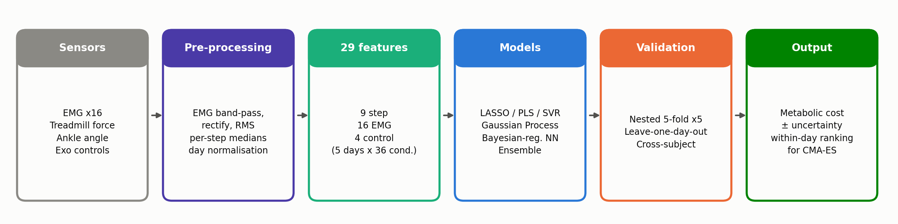
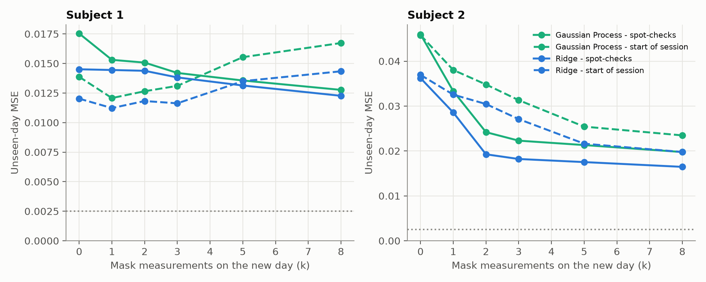
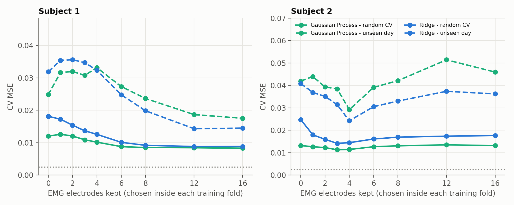

# MetaCost - Predicting Metabolic Cost During Human-in-the-Loop Optimisation

**UE24CS352A Machine Learning - Mini-Project (Problem #11)**
Team: **Mukil Skanda A** (PES1UG24CS281) · **Likhith M** (PES1UG24CS282)
Repository: https://github.com/Mukilskanda/Predicting-Metabolic-Cost-During-Human-in-the-Loop-Optimisation (private)

Exoskeleton controllers are tuned online by *human-in-the-loop optimisation* (HILO): a CMA-ES
optimiser tries a new assistance profile every 2 minutes and keeps the ones that minimise the
wearer's **metabolic cost**. But metabolic cost is measured with a face mask (indirect
calorimetry) - it is slow (~1 min to settle), noisy and lab-only.

This project predicts metabolic cost from **wearable signals** - 16 EMG channels, 9 gait/step
features from the treadmill, and the 4 exoskeleton control parameters - so HILO could one day
run outside the lab. It reproduces and extends Krimsky & Ng, *"Predicting Metabolic Cost During
Human-in-the-Loop Optimization"* (Stanford CS229, 2018).



## Headline results

| | Subject 1 | Subject 2 |
|---|---|---|
| Predict-the-mean baseline MSE | 0.0665 | 0.0365 |
| **Paper** reference (linear regression, its own CV) | 0.0089 | 0.0168 |
| **Ours** best (repeated nested 5-fold CV) | **0.0079** (Ensemble, R² = 0.88) | **0.0109** (SVR, R² = 0.71) |
| Ours, **unseen day** (leave-one-day-out) | 0.0140 (R² = 0.79, ~12 % error) | 0.0263 (R² = 0.27) |
| Ours, unseen day **+ 3 mask spot-checks** (calibration) | **0.0138** (Ridge) | **0.0171** (LASSO, −35 %) |
| Measurement-noise floor | 0.0025 | 0.0025 |

Main findings
1. **Lower MSE than the paper's reference scores** on both subjects (0.0079 vs 0.0089; 0.0109 vs 0.0168). The models and CV setups differ (best of 13 models with repeated nested 5-fold vs the paper's linear regression with its own CV), so this is not a like-for-like comparison.
2. **Random-split CV is optimistic.** Holding out a whole *day* (the realistic deployment case, which the paper names as the ideal test but never runs) roughly doubles the error. Subject 1 still generalises (r = 0.88); Subject 2 does not, because its day-to-day level shifts are not captured by the sensors.
3. **EMG matters most** for both subjects (grouped permutation importance). The top muscles are stable across 200 LASSO bootstraps.
4. **Supervised beats unsupervised dimensionality reduction.** One PLS component matches 8 PCA components on Subject 2, which explains the paper's poor PCA result.
5. **One model per person.** Training on one subject and testing on the other is *worse than predicting the mean*. Subject-wise z-scoring helps a lot but is not enough.
6. **Small networks only.** Our re-implementation of MATLAB's `trainbr` picks 1-2 hidden neurons, consistent with the paper's "no benefit beyond 3".
7. **More data would help.** Subject 1's learning curve is still falling at 144 training samples (0.0155 → 0.0088 for the GP).
8. **Fixes that work without new data** (see *Improvements* below): 3 mask spot-checks per session plus an empirical-Bayes offset halve Subject 2's unseen-day error, and 4 well-chosen EMG electrodes beat all 16 for Subject 2.

## Improvements: fixing the weaknesses (`scripts/run_improvements.py`)

The first round exposed three weaknesses. Follow-up experiments E10-E12 test fixes that need no new data:

| Weakness | Fix tested | Result |
|---|---|---|
| Error ~doubles on a new day | **Session calibration:** measure *k* random conditions with the mask, then shift the day's predictions by an **empirical-Bayes shrunken offset** (`metacost/calibration.py`) | With **k = 3 of 36** (92 % fewer mask readings), unseen-day MSE for S2 falls **0.0460 → 0.0223 (GP, −51 %)** and 0.0362 → 0.0182 (Ridge, −50 %). For S1 it falls 0.0175 → 0.0142 (GP, −19 %). |
| Too many sensors (16 EMG electrodes) | **Sensor reduction:** keep the *k* EMG channels that enter the LASSO path first, chosen inside each training fold | S2 with only **4 electrodes beats all 16**: unseen-day Ridge 0.0362 → 0.0242 (−33 %), random-CV GP 0.0132 → 0.0114. S1 needs ~8 electrodes for the GP to stay within 3 % of the full set (random CV). |
| Models don't transfer between people | Transfer + offset/scale recalibration on *k* samples of the new person | **Doesn't help** (honest negative): no better than averaging the k samples. From k ≈ 5-10, a model trained only on the new person's own samples wins. |

Why random spot-checks and shrinkage: calibrating on the *first* conditions of a session made S1 **worse**
(Ridge 0.0120 → 0.0184 at k = 8 without shrinkage, 0.0143 with it), because metabolic cost runs high early in each session (warm-up). The
empirical-Bayes weight w = k / (k + σ²/τ²) is learned from the training days. It trusts calibration for S2
(w ≈ 0.87 at k = 3), whose day shifts are large, and much less for S1 (w ≈ 0.56-0.76).




Not attempted, because they need data this study does not contain: more subjects, anthropometrics, IMU
kinematics, and closed-loop CMA-ES with the surrogate (that would need the cost of conditions that were never run).

## Two layers: paper reproduction + extended study

| Folder | Purpose |
|---|---|
| `paper_reproduction/` | **Faithful Python port of the original MATLAB scripts** (one file per `.m` script): 1-hidden-layer network vs. linear regression, 4 feature sets, 5-fold CV. Simple and traceable. See its own [README](paper_reproduction/README.md). |
| `metacost/` + `scripts/` | **Extended study**: 13 models, nested CV, leave-one-day-out, from-scratch `trainbr`, calibration, sensor reduction. |

The reproduction confirms the paper's numbers (S1 Lin. Reg. 0.0107 vs paper 0.0089; S2 0.0172 vs 0.0168);
the extended study then improves on them.

**Note on `trainbr`.** scikit-learn has no Bayesian-regularised training, so the reproduction uses `MLPRegressor`
with a fixed L2 penalty; its NN numbers are not an exact copy of MATLAB's. `metacost/bayesian_mlp.py` closes
that gap by re-implementing `trainbr` (Levenberg-Marquardt + MacKay evidence updates), unit-tested against
finite differences.

## Repository layout

```
paper_reproduction/       faithful 1:1 Python port of the original MATLAB scripts (baseline)
metacost/                 Python package
  data.py                 loads the .mat file, feature names, feature groups, day/condition ids
  bayesian_mlp.py         from-scratch Bayesian-regularised NN (Levenberg-Marquardt + MacKay evidence = MATLAB trainbr)
  models.py               13-model zoo, every model a leakage-free sklearn pipeline with inner-CV tuning
  evaluation.py           metrics, random K-fold and leave-one-day-out protocols
  calibration.py          empirical-Bayes session calibration + in-fold EMG sensor selection
scripts/
  run_experiments.py      runs experiments E1-E9, writes results/tables/*.csv, results.json, saved models
  run_improvements.py     follow-up experiments E10-E12 (calibration, cross-subject, sensor reduction)
  make_figures.py         renders every figure in results/figures/
  predict.py              CLI inference / terminal demo
tests/test_pipeline.py    unit tests (data integrity, Jacobian check, model sanity)
data/raw/                 original processed data from the study (processed_data.mat)
data/hilo_metabolic_dataset.csv   the same data as a tidy CSV (written by run_experiments.py)
results/                  tables, figures, saved models (all reproducible)
docs/                     write-up (PDF) and presentation (PPTX)
```

## Setup

Python 3.10+ is required (tested on 3.13).

```bash
python -m venv .venv
# Windows: .venv\Scripts\activate      macOS/Linux: source .venv/bin/activate
pip install -r requirements.txt
```

## Run

```bash
# 0. faithful reproduction of the paper (~2 min)
python paper_reproduction/k_fold_cv.py

# 1. all experiments (~8 min on 16 cores; add --quick for a ~3 min smoke run)
python scripts/run_experiments.py

# 2. follow-up experiments (~1 min)
python scripts/run_improvements.py

# 3. all figures
python scripts/make_figures.py

# 4. tests
python -m pytest -q

# 5. demo: train on 4 days, predict the unseen 5th day
python scripts/predict.py --demo --subject S1
python scripts/predict.py --csv data/hilo_metabolic_dataset.csv --subject S2 --out preds.csv
```

The results, figures and the model used by `predict.py` are already committed, so the demo runs straight after `pip install`.

## Live demo (commands only)

Run from the project root:

```bash
python paper_reproduction/lin_reg_test.py       # paper baseline: Lin. Reg. MSE 0.0107, R² 0.83 (S1)
python scripts/predict.py --demo --subject S1   # train on 4 days, predict each unseen day
python -m pytest -q                             # 10 tests pass
```

## Dataset

Stanford Biomechatronics Laboratory HILO study (bilateral ankle exoskeleton, naive users), as
released by Krimsky & Ng with their CS229 project. Two subjects × 5 days × 36 control conditions
(2 min each; the last 30 s are used). One Subject-2 row has a physically impossible negative
metabolic rate and is dropped, as in the original study, leaving **180 + 179 samples × 29 features**.

| Group | # | Features |
|---|---|---|
| Step / gait | 9 | L/R peak vertical GRF (normalised by body weight), L/R peak dorsiflexion & plantarflexion angle, L/R step time, step width (per-step medians) |
| EMG | 16 | 8 muscles per leg; band-pass → rectify → low-pass → RMS, normalised by that day's normal-walking peak |
| Control | 4 | peak torque, peak time, rise time, fall time of the exoskeleton torque profile |
| **Target** | 1 | metabolic rate minus that day's standing baseline, divided by that day's normal-walking rate (1.0 = unassisted walking) |

## Methodology (summary)

* **Leakage-free pipelines.** Scaling and hyper-parameter search happen inside each training fold (nested CV).
* **Two validation protocols.** (a) repeated nested 5-fold CV (5 × 5), for comparison with the paper's reference scores; (b) leave-one-day-out (honest generalisation to a new session).
* **Models.** OLS, LASSO, Ridge, Elastic Net, PLS, kNN, SVR, Random Forest, Extra Trees, Gradient Boosting, Gaussian Process (linear + RBF + noise kernel, gives uncertainty), Bayesian-regularised NN, and an averaging ensemble.
* **Analyses.** Feature-set ablation, neuron sweep, permutation and LASSO-stability importance, PCA/PLS/forward selection, learning curves, GP calibration, cross-subject transfer, within-day rank correlation (what CMA-ES actually needs).

## References
1. E. Krimsky, E. Ng. *Predicting Metabolic Cost During Human-in-the-Loop Optimization.* CS229, Stanford, 2018.
2. J. Zhang et al. *Human-in-the-loop optimization of exoskeleton assistance during walking.* Science 356 (6344), 2017.
3. D. J. C. MacKay. *Bayesian Interpolation.* Neural Computation 4(3), 1992.
4. F. D. Foresee, M. T. Hagan. *Gauss-Newton approximation to Bayesian learning.* ICNN 1997.
5. C. E. Rasmussen, C. K. I. Williams. *Gaussian Processes for Machine Learning.* MIT Press, 2006.
